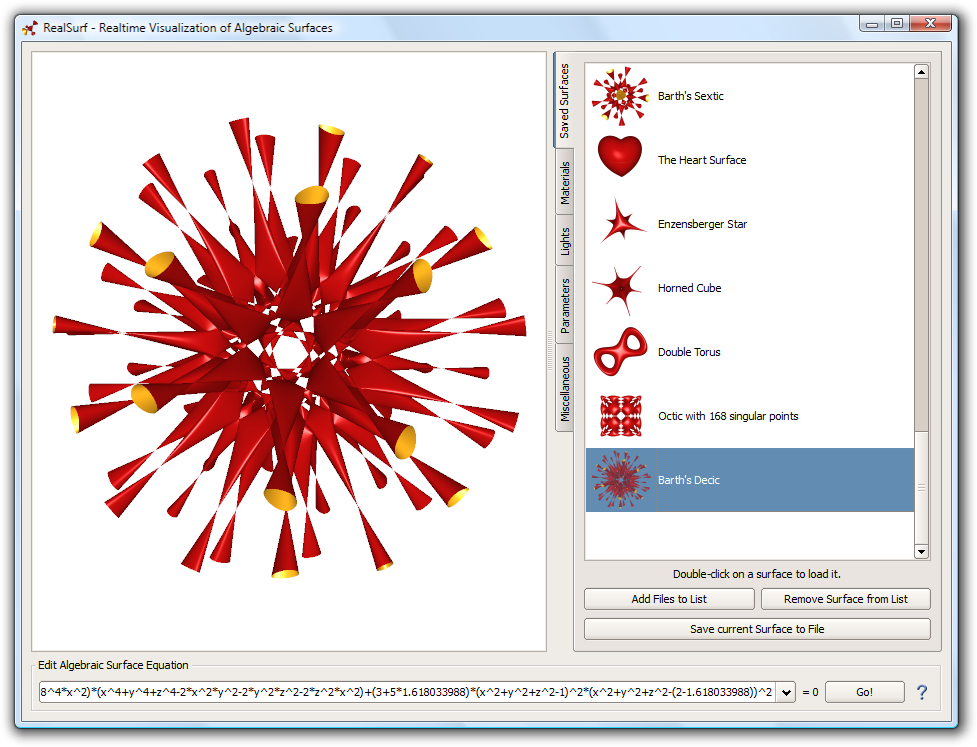

# RealSurf

RealSurf is a GPU-based realtime raytracer for real algebraic surfaces, the
solutions of polynomial equations `F(x,y,z) = 0` in three variables. It supports
interactive positioning, rotation, and zooming of surfaces, as well as live
adjustment of surface parameters.

## Project layout

- `RealSurf/` — the standalone GLUT viewer and rendering core, including the
  expression parser, shader generation and management, and MathGL math
  utilities.
- `QT-Gui/` — the Qt desktop interface, including the surface equation editor,
  parameter, material, and light controls, saved surfaces, and benchmark mode.

## License

RealSurf is released under the [Apache License 2.0](LICENSE).

Copyright (C) Christian Stussak.
